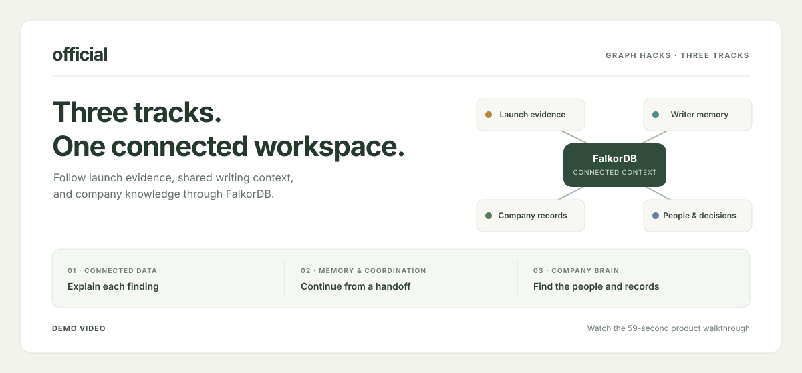

<h1 align="center">
  
</h1>

<p align="center"><strong>Evidence-backed launch reviews, approved writer handoffs, and connected company records.</strong></p>

<p align="center">
  <a href="https://official-sand.vercel.app/"></a>
  
  
  
  
  
  
</p>

<p align="center">Track 01 · Connected data &nbsp;|&nbsp; Track 02 · Agent memory and coordination &nbsp;|&nbsp; Track 03 · Company Brain</p>

## Overview

**One application across all three tracks.** This repository contains the integrated official workspace for Track 01, Track 02, and Track 03. Its connected-data checks, writer memory, and company records run in one app and share one FalkorDB graph.

official helps a team check launch claims, pass approved context to writers, and find company records. The app shows why a claim is Supported, Contradicted, Unknown, or Not checked. A person must approve a change before the app applies it.

The demo uses fictional Alder & Finch and Northstar Parcel workspaces. Do not enter private or customer data.

## What each track does

| Track | What we built |
| --- | --- |
| **01 · Connected data** | Checks campaign claims against linked feature, deployment, rollout, test, and source records. Shows the result and its evidence path. |
| **02 · Memory and coordination** | Saves an approved brief and reviewed feedback in FalkorDB. A new writer session reads this context and the current Track 01 findings. The app checks the brief and evidence versions before approval. |
| **03 · Company Brain** | Links company notes to projects, decisions, sources, people, and processes. Shows reviewed owners and approved backup coverage for launch handovers. |

## How the tracks connect

All three tracks use the same FalkorDB graph and company context. Track 01 provides current evidence. Track 02 gives that evidence and an approved brief to a new writer session. Track 03 links the work to its owners and company records. The two demo companies have separate workspaces in the graph.

## Key features

- **Evidence paths:** each finding shows the records behind it.
- **Freshness checks:** the app checks current brief and evidence versions before approval.
- **Human approval:** a reviewer must approve a proposed change. The demo does not publish content or change a live product rollout.
- **Company context:** search notes, sources, decisions, and ownership records.
- **Review history:** FalkorDB stores checks and demo actions as activity records.

## Demo

<p align="center">
  
</p>

<p align="center"><strong>Demo video coming soon.</strong> Start at the <a href="https://official-sand.vercel.app/">official site</a> for the overview and link to the workspace.</p>

<!-- When the recording is ready, link the poster to its public video URL:
[](VIDEO_URL)
-->

## Run it locally

You need **Node.js 22 or later** and **Docker Compose**. The commands below start FalkorDB and the local app.

```powershell
Copy-Item .env.example .env
docker compose up -d
npm ci
npm run dev
```

Open [http://127.0.0.1:3001/](http://127.0.0.1:3001/). Start at the marketing page, then select **Open review workspace** to enter the app. The sample environment uses fictional data. Keep credentials in `.env`; do not commit them.

To run the checks:

```powershell
npm test
npm run build
```

## Graph model

FalkorDB is the primary graph database. These paths show how each track uses it:

| Track | Example graph path |
| --- | --- |
| Connected data | `Draft → Promise → Feature → Deployment / Rollout / Test → Source` |
| Memory and coordination | `Handoff → Task → Campaign → InstructionVersion / ReviewEpisode` |
| Company Brain | `Company → Project → Process → Person`; `Process → KnowledgeNote → Source / Decision` |

<details>
<summary>Example Cypher query used by the claim checker</summary>

```cypher
MATCH (campaign:Campaign {id: $campaignId})<-[:IN_CAMPAIGN]-(draft:Draft)
OPTIONAL MATCH (draft)-[:MAKES_PROMISE]->(directPromise:Promise)
OPTIONAL MATCH (draft)-[:REUSES_DRAFT]->(reusedDraft:Draft)-[:MAKES_PROMISE]->(reusedPromise:Promise)
WITH campaign, draft, coalesce(directPromise, reusedPromise) AS promise
OPTIONAL MATCH (promise)-[:ABOUT]->(feature:Feature)
OPTIONAL MATCH (promise)-[:TARGETS]->(audience:Audience)
RETURN DISTINCT draft.id AS draftId, promise.id AS promiseId,
       feature.id AS featureId, audience.id AS audienceId
```

The server sends fixed queries with IDs as parameters. The browser does not connect to FalkorDB.

</details>

## More project detail

- [Connected workspace](docs/CONNECTED-WORKSPACE.md) — track workflows, reviewer steps, and current limits.
- [Graph model and queries](docs/GRAPH-MODEL-AND-QUERIES.md) — full graph structure, status rules, and Cypher.
- [Architecture](docs/ARCHITECTURE.md) — product flow and code structure.
- [Implementation status](docs/IMPLEMENTATION-STATUS.md) — checks, deployment notes, and remaining work.

## Scope and disclosure

This demo uses synthetic data. It does not import customer data, authenticate reviewers, monitor work in the background, or publish content. Optional OpenAI assistance is available in a configured local development instance. When used, it sends prompts and synthetic tool results to OpenAI. Coding assistants helped with research, code, and documentation. The team must review and understand the submitted work.
